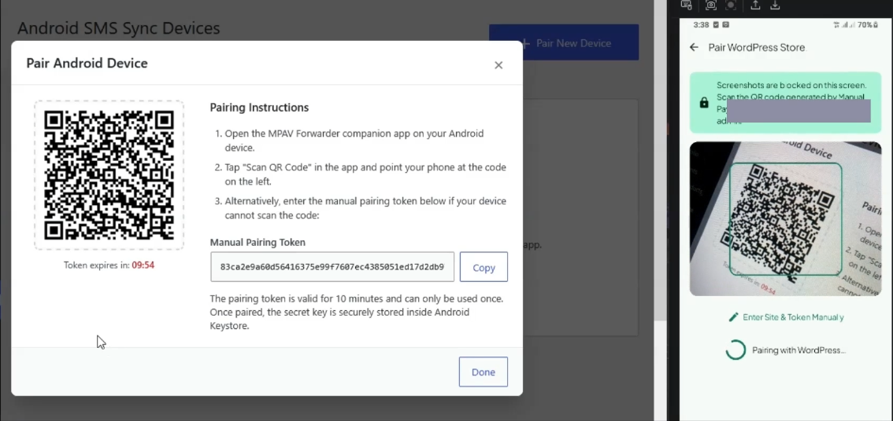
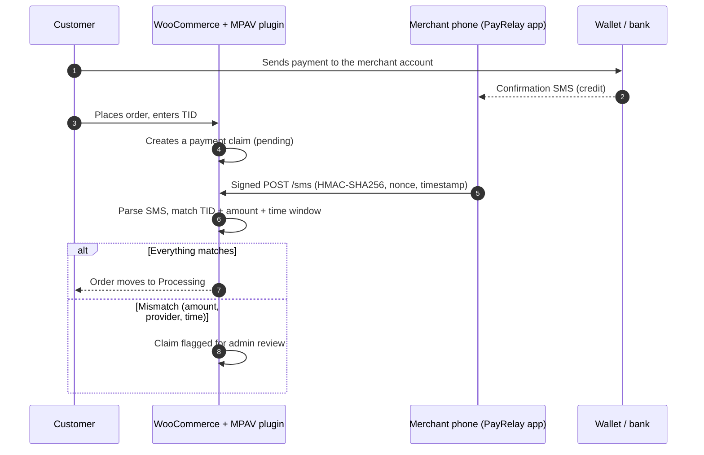

<div align="center">

# PayRelay · WooCommerce SMS Auto-Verify

**Verify manual mobile-wallet and bank-transfer payments automatically.**
A WooCommerce plugin plus a companion Android app that relays your payment SMS to your store over signed, replay-protected requests. No SMS gateway, no monthly fees.

[](#requirements)
[](#requirements)
[](#requirements)
[](#android-app-payrelay)
[](#license)
</div>

---

## 🎬 App Demo

<p align="center">
  <a href="https://youtube.com/shorts/Kg9585oUc0k">
    
  </a>
</p>
*Click the screenshot above to watch the app in action on YouTube.*

---

## Table of contents

- [Why this exists](#why-this-exists)
- [How it works](#how-it-works)
- [Features](#features)
- [Requirements](#requirements)
- [Quick start](#quick-start)
- [SMS parsing and matching](#sms-parsing-and-matching)
- [Admin tools](#admin-tools)
- [Android app (PayRelay)](#android-app-payrelay)
- [Security and privacy](#security-and-privacy)
- [REST API](#rest-api)
- [Configuration](#configuration)
- [Troubleshooting](#troubleshooting)
- [Documentation](#documentation)
- [License](#license)

---

## Why this exists

In Pakistan many stores accept payment by mobile wallet or bank transfer, then ask the customer for a Transaction ID (TID). The merchant opens the wallet or banking app, finds the payment by hand, and only then moves the order from *On hold* to *Processing*. That is slow, error-prone and does not scale.

**PayRelay removes the manual step.** The merchant's own Android phone already receives the payment confirmation SMS. The companion app forwards it to the store, the plugin matches it with the customer's claim, and the order is confirmed within seconds.

## How it works



The SMS and the customer's TID can arrive **in either order**. If the SMS comes first it is stored (as parsed fields only) and matched the moment the claim is created. A background job re-checks pending claims as a safety net, so a claim is never expired while its SMS is already in the database.

## Features

### WordPress plugin (Manual Payment Auto-Verify)

- **Manual payment gateway** for mobile wallets and bank transfer, with account number, QR code and per-provider instructions.
- **Classic and Block checkout** support, with a redesigned step-by-step payment UI ("Amount to send", provider cards, copy button, QR).
- **Automatic verification** of TID + amount + time window, in either arrival order.
- **Universal SMS extractor** that understands any wallet or bank SMS format, not only fixed templates (see [SMS parsing](#sms-parsing-and-matching)).
- **Safe by default:** credit-only, PKR-only, one claim per TID, optimistic locking on every state change.
- **No screenshots needed:** the matched SMS is the proof of payment, so customers only enter a TID.
- **Verification queue** in wp-admin with status tabs, provider filter, bulk actions and a single search box (order number or TID) with match highlighting.
- **Device manager:** pair via QR, revoke a device, clear all devices, see the last-seen time of every phone, and the page refreshes by itself the moment a phone finishes pairing. Re-pairing the same phone reuses its row.
- **Audit Log** of every transition, review and device action.
- **Automatic expiry** of stale claims and housekeeping of old data (Action Scheduler).
- **GDPR tooling:** WordPress personal data exporter and eraser, phone numbers masked, raw SMS text never stored.

### Android app (PayRelay)

- **QR pairing** (CameraX + ML Kit) or manual site URL + token entry.
- **Sender allowlist** with common Pakistani wallet and bank senders by default; fully editable.
- **Offline-first outbox** (Room) with WorkManager retries and exponential backoff; the SMS body is wiped after delivery.
- **Heartbeat** every 15 minutes so the store can see the device is alive.
- **Privacy controls:** consent screen, biometric lock, `FLAG_SECURE` on sensitive screens, configurable retention, one-tap *Unpair and wipe*.
- **Reliability guide** with OEM-specific battery-optimization instructions so SMS forwarding keeps running in the background.
- **Logs screen** with redacted entries.

## Requirements

| Component | Requirement |
|-----------|-------------|
| WordPress | 6.0 or newer |
| WooCommerce | 8.0 or newer (tested up to 9.4) |
| PHP | 7.4 or newer, with `libsodium` or OpenSSL AES-256-GCM |
| Site | **HTTPS** (the app refuses plain HTTP) |
| Merchant phone | Android phone that receives the wallet / bank SMS, with camera (for QR pairing) |
| Build tools | Android Studio (latest stable) to build the app from source |

## Quick start

### 1. Install the plugin

1. Copy `plugin/manual-payment-autoverify` to `wp-content/plugins/`, or zip the folder and use **Plugins → Add New → Upload**.
2. Activate it.
3. Go to **WooCommerce → Settings → Payments → Manual Payment (Mobile Wallet / Bank Transfer) → Manage**.
4. Enable the gateway, add your account numbers and titles, and optionally a QR code and instructions.

### 2. Build and install the app

1. Open `android-app/` in Android Studio and let Gradle sync.
2. Run it on the merchant phone (or build a release APK and install it).
3. Accept the consent screen and grant the SMS permission when asked.
4. Follow the in-app **Reliability guide** to exempt the app from battery optimization (important on Xiaomi, Oppo, Vivo, Samsung and similar).

### 3. Pair the phone

1. In wp-admin open **Manual Payments → Devices** and click **Pair New Device**.
2. Scan the QR code in the app (or enter the site URL and token manually).
3. The page refreshes by itself as soon as the phone connects.

### 4. Test a payment

1. Place a test order with the gateway and send the amount to your account from another wallet.
2. Enter the TID at checkout.
3. When the credit SMS reaches the merchant phone, the order moves to **Processing**. Anything that does not match lands in the **Verification Queue** with a reason.

## SMS parsing and matching

Strict parsers for the two most common wallet message formats run first. When a message does not fit, the **universal extractor** takes over:

| Step | What it does |
|------|--------------|
| **Direction** | Accepts only incoming (credit) messages. "You sent Rs 500 to ..." can never verify a claim. |
| **Currency** | PKR only. `$500` never matches `Rs 500`. |
| **Amount** | Every amount candidate is scored. Balance, limit and due figures are penalised, fees and taxes are penalised, credit keywords nearby are rewarded. The best score wins. |
| **Transaction ID** | Keyword match first (`TID`, `Trx ID`, `Txn No`, `Ref #`, `RRN`, `UTR` ...), ranked by priority. Otherwise a guarded long-token fallback that ignores phone numbers, dates, masked accounts and IBANs. |
| **Provider** | Detected from the sender or message text for known wallets; anything else is treated as a generic `bank`. |

A claim is verified automatically only when **all** of these hold:

1. TID matches (normalised, case and spaces ignored).
2. Amount matches the order total exactly (integer paisa, no floats).
3. The SMS time falls inside the allowed window: at most *N* minutes before the claim was created, or any time until the claim expires.
4. The provider is the same one the customer chose.

Otherwise the claim is **flagged** with a human-readable reason (amount mismatch, provider mismatch, time window exceeded) for manual review.

Claim states: `pending` → `auto_verified` · `flagged` · `rejected` · `expired`.

## Admin tools

| Screen | What you can do |
|--------|-----------------|
| **Verification Queue** | Filter by status and provider, search by order number or TID, approve or reject, bulk actions. |
| **Devices** | Pair a phone, revoke one device, **Clear All Devices**, see when each phone was last seen. A green dot means it contacted the store in the last 5 minutes. The page refreshes itself when a phone pairs. |
| **Audit Log** | Append-only trail of transitions, reviews and device actions. |
| **Settings** | SMS match window, claim expiry, SMS retention. |

## Android app (PayRelay)

**Stack:** Kotlin, Jetpack Compose (Material 3), Hilt, Room, DataStore, WorkManager, CameraX, kotlinx.serialization, Retrofit + OkHttp, AndroidX Biometric.

**Architecture:** clean layers (`data` / `domain` / `ui`) with use cases:

| Use case | Responsibility |
|----------|----------------|
| `PairDeviceUseCase` | Exchanges the pairing token for a device ID and secret. |
| `FilterAndEnqueueSmsUseCase` | Allowlist + pause check, then stores the SMS in the outbox. |
| `SyncOutboxUseCase` | Signs and uploads pending messages, handles retry or permanent failure. |
| `SendHeartbeatUseCase` | Periodic liveness ping. |
| `UnpairAndWipeUseCase` | Cancels work, deletes the keystore key and wipes local data. |

**Distribution:** the app is distributed as an APK (see the repository's Releases page). It is not published on Google Play, because Play restricts SMS permissions to default SMS, phone and assistant apps. Android may show an "install unknown apps" prompt the first time.

**Stable device identity:** the app sends a random per-install UUID when pairing, so re-pairing the same phone reuses its server-side device row instead of adding a duplicate. It is stored outside Auto Backup and is not derived from any hardware identifier.

**Permissions:** `RECEIVE_SMS` (incoming payment SMS), `CAMERA` (QR pairing only), `POST_NOTIFICATIONS` (Android 13+, for the sync status notification), and network access. The app does not request `READ_SMS`, so the existing inbox is never read; only new incoming messages from allowlisted senders are processed.

**Run the tests:**

```bash
./gradlew testDebugUnitTest
```

## Security and privacy

Designed against the STRIDE model. Highlights (full matrix in [`docs/SECURITY.md`](docs/SECURITY.md)):

| Layer | Protection |
|-------|-----------|
| Authentication | Per-device secret, `HMAC-SHA256` over `METHOD + path + timestamp + nonce + SHA-256(body)`, compared in constant time. |
| Replay | Unique nonce stored atomically (primary key) plus a ±300 s timestamp window. |
| Tampering | Body hash is part of the signed string, so any edit invalidates the signature. |
| Information disclosure | Failed auth returns a uniform `401`; raw SMS text is never stored, only parsed fields and a one-way hash. |
| At rest (server) | Device secrets encrypted with libsodium or AES-256-GCM, keys derived from WordPress salts via HKDF-SHA256. |
| At rest (phone) | Pairing secret encrypted with an Android Keystore AES-GCM key; message bodies wiped after delivery. |
| Abuse | Body size caps (64 KB `/sms`, 1 KB `/heartbeat`), rate limits (per device and per IP, plus a strict limit on `/pair`), linear-time parsers. |
| Data integrity | `UNIQUE (provider, tid_normalized)`, optimistic locking on state transitions, append-only audit log. |
| Admin | Capability checks (`manage_woocommerce`) and nonces on every admin action. |
| Privacy | WordPress exporter and eraser, masked phone numbers, consent screen, retention controls, `FLAG_SECURE`, biometric lock. |
| Transport | HTTPS only; the app rejects plain HTTP site URLs. |


## REST API

Base: `/wp-json/mpav/v1`

| Method | Endpoint | Auth | Purpose |
|--------|----------|------|---------|
| `POST` | `/pair` | One-time pairing token | Registers a device. Body: `pairing_token`, `device_name`, optional `device_uuid`. Returns `device_id` and `secret` (shown once). Limited to 5 requests per minute per IP. |
| `POST` | `/sms` | HMAC | Receives a forwarded SMS from a paired device. |
| `POST` | `/heartbeat` | HMAC | Device liveness and diagnostics. |

Signed requests carry these headers:

```text
X-MPAV-Device:     <device id>
X-MPAV-Timestamp:  <unix seconds, ±300 s>
X-MPAV-Nonce:      <lowercase hex, 32-128 chars, single use>
X-MPAV-Signature:  <hex HMAC-SHA256 of the canonical string>
```

## Configuration

| Setting | Where | Default |
|---------|-------|---------|
| Providers, account numbers, QR, instructions | WooCommerce → Payments → Manual Payment | n/a |
| SMS match window (minutes) | Manual Payments → Settings | 60 |
| Claim expiry (minutes) | WooCommerce → Payments → Manual Payment (minimum 30) | 1440 (24 h) |
| SMS retention (days) | Manual Payments → Settings | 90 |
| Disable the universal extractor | `add_filter( 'mpav_enable_universal_sms_parsing', '__return_false' );` | enabled |
| Custom provider patterns | The `mpav_*_patterns` filters | built-in |

## Troubleshooting

| Symptom | Likely cause and fix |
|---------|----------------------|
| SMS reaches the server but nothing verifies | The message is a **debit** ("you sent ..."). Only credit SMS received on the merchant phone count. Test from a different account. |
| Claim flagged "Amount mismatch" | The customer paid a different amount than the order total. Approve or reject it from the queue. |
| Claim flagged "Time window exceeded" | The SMS is older than the allowed window. Increase the window in Settings if appropriate. |
| Phone stops forwarding after a while | OEM battery optimization. Follow the in-app Reliability guide. |
| Checkout looks unstyled after an update | Clear your cache / CDN. Assets are versioned by file time, so a normal refresh should pick them up. |
| Re-paired phone shows as a new device | Happens after uninstall or *Clear storage* (a new install UUID is generated). Revoke the old entry or use *Clear All Devices*. |
| Device number keeps growing (`ID: #5`, "Device 5") | That number is the database ID of the device row. It only goes up, even after devices are deleted or revoked, so it is not a count of devices. Look at the device name, not the ID. |
| Pairing window stays open and nothing happens | The phone has not completed pairing yet. Check that the site uses HTTPS, the token is not expired (10 minutes) and the phone has internet access. The page refreshes by itself once pairing succeeds. |

## Documentation

| Document | Contents |
|----------|----------|
| [`ARCHITECTURE.md`](docs/ARCHITECTURE.md) | Components, database schema, claim state machine, matching flow. |
| [`GATEWAY-SETUP.md`](docs/GATEWAY-SETUP.md) | Gateway settings, pairing a phone, webhook and signing specification. |
| [`SECURITY.md`](docs/SECURITY.md) | STRIDE threat matrix and production checklist. |

## License

Unless stated otherwise in a subdirectory, this repository is released under **GPL-2.0-or-later**. See [LICENSE](LICENSE) for the full text.

## Disclaimer

This is an independent open-source project. It is **not affiliated with or endorsed by** any mobile wallet provider or bank. All product names, logos and trademarks belong to their respective owners; names and short codes appear only to recognise incoming messages. The software is provided "as is", without warranty. Verify important payments yourself, and make sure your use complies with local regulations and respects your customers' privacy.
