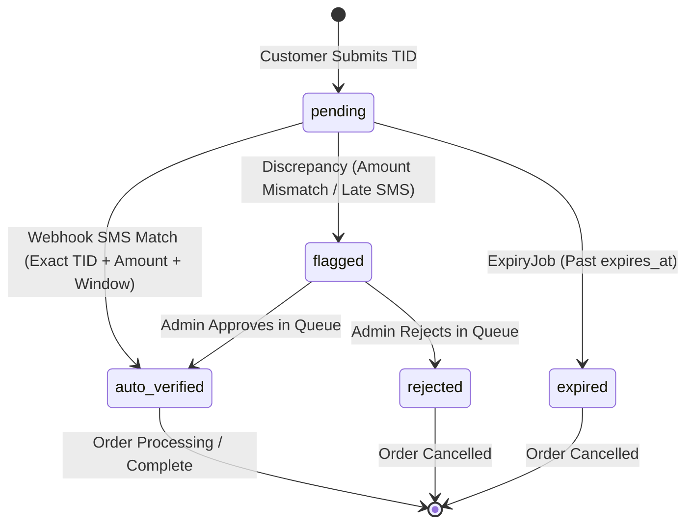
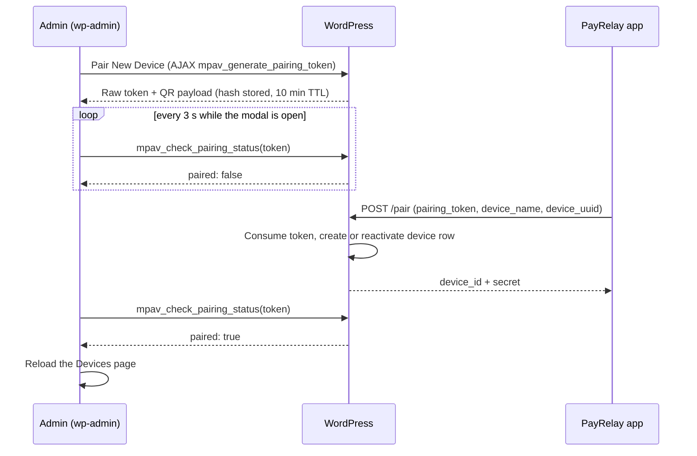

# Manual Payment Auto-Verify — System Architecture

## 1. Overview & Architectural Goals

**Manual Payment Auto-Verify for WooCommerce (MPAV)** provides an automated, secure, and auditable verification layer for manual mobile wallet payments (JazzCash, Easypaisa) and direct bank transfers in Pakistan. It works together with the **PayRelay** Android app, which forwards the merchant's incoming payment SMS to the store.

Traditional manual payments in Pakistan require merchants to manually check customer-submitted Transaction IDs (TIDs) against their personal mobile banking apps or SMS inboxes, causing fulfillment delays, fraud vulnerabilities, and accounting errors. MPAV automates this process by pairing a merchant Android phone via a secure, authenticated webhook that forwards incoming payment confirmation SMS messages directly to WordPress.

### Key Architectural Invariants
1. **Never Trust the Client:** Customer-provided TIDs are treated as untrusted claims. They are never authoritative; only a matching SMS from a paired device can verify a claim.
2. **One-Way SMS Forwarding & Cryptographic Privacy:** Raw SMS text is never stored permanently. Inbound messages are parsed in memory and checked against pending claims. Only the parsed fields (provider, TID, amount) and a one-way SHA-256 hash of the body are stored (`mpav_sms_messages`).
3. **Finite State Machine (FSM) Invariance:** Claims transition strictly along validated state transitions wrapped in InnoDB ACID transactions with optimistic locking.
4. **Zero Float Money Handling:** All monetary calculations use integer minor units (paisa: 1 PKR = 100 paisa) and BCMath. Floating-point numbers are strictly prohibited.
5. **Defense in Depth (STRIDE):** Anti-replay nonces, constant-time HMAC-SHA256 signatures, authenticated encryption at rest (libsodium/AES-256-GCM), rate limiting, and directory shielding.

---

## 2. Component Architecture

```
[ Customer Checkout ]
        │
        ├──> (Order Created: pending payment)
        ├──> [ MpavGateway ] ───> Presents Payment Instructions & QR Code
        └──> [ CheckoutFields / Order Received Form ]
                 │
                 ├── Customer enters TID & Sender Phone
                 ▼
          [ ClaimRepository ] ──────> Creates Claim (status: 'pending')
```

```
[ Merchant Android Device ]
        │  (Receives SMS from JazzCash 8558 / Easypaisa 3737)
        │
        ▼  Signs payload: HMAC-SHA256(secret, METHOD + PATH + TS + NONCE + SHA256(BODY))
   [ REST API: /wp-json/mpav/v1/sms ]
        │
        ├── [ RateLimiter ] ───────> Per-IP & Per-Device fixed window (transients)
        ├── [ HmacAuthenticator ] ──> Constant-time signature verification
        ├── [ NonceStore ] ────────> Single-use replay prevention (mpav_used_nonces)
        ▼
   [ SmsParserService ] ───────────> Provider Parsers (JazzCashParser, EasypaisaParser)
        │                             - ReDoS-safe regexes
        │                             - Extracts: TID, Amount (paisa), Sender, Timestamp
        ▼
   [ ClaimMatcherService ]
        │
        ├── Queries pending claim matching (provider, tid_normalized)
        ├── Validates amount in minor units
        ├── Validates SMS timestamp within matching window
        │
        ├── MATCH SUCCESS:
        │     └── [ ClaimStateMachine ] ──> Transition: 'pending' -> 'auto_verified'
        │               │
        │               ├── Emits atomic audit log entry
        │               └── Fires 'mpav_claim_transitioned'
        │                         │
        │                         ▼
        │                  [ WooCommerce Order ] ──> $order->payment_complete(tid)
        │
        └── MISMATCH / SUSPICIOUS:
              └── [ ClaimStateMachine ] ──> Transition: 'pending' -> 'flagged'
                        │
                        ▼
                 [ Admin Queue ] ───> Surfaced to merchant for manual review
```

---

## 3. Database Schema & Storage Model

All tables use `InnoDB` engine with UTF8MB4 charset.

| Table Name | Description | Key Indexes |
|------------|-------------|-------------|
| `wp_mpav_claims` | Customer payment claims | `PRIMARY KEY (id)`, `UNIQUE KEY (provider, tid_normalized)`, `KEY (order_id)`, `KEY (status)`, `KEY (expires_at)` |
| `wp_mpav_devices` | Paired merchant Android devices | `PRIMARY KEY (device_id)`, `UNIQUE KEY (device_uuid)`, `KEY (revoked_at)` |
| `wp_mpav_pairing_tokens` | Ephemeral one-time pairing tokens (SHA-256 hash only) | `PRIMARY KEY (token_hash)`, `KEY (expires_at)` |
| `wp_mpav_sms_messages` | Parsed SMS fields & body hash | `PRIMARY KEY (id)`, `UNIQUE KEY (device_id, idempotency_key)`, `KEY (parsed_provider, parsed_tid)`, `KEY (received_at)` |
| `wp_mpav_used_nonces` | Webhook anti-replay nonces | `PRIMARY KEY (nonce)`, `KEY (expires_at)` |
| `wp_mpav_audit_log` | Append-only audit trail | `PRIMARY KEY (id)`, `KEY (claim_id)`, `KEY (created_at)` |

> **Device IDs:** `device_id` is an `AUTO_INCREMENT` integer. It never goes down, even after rows are deleted, so a high number does not mean many devices are paired. `device_uuid` is the random per-install ID sent by the Android app; it is what lets a re-paired phone reuse its existing row.
>
> **Unused columns:** `claims.screenshot_path` and `claims.ocr_tid` are kept for data created by older versions; new claims leave them empty.

---

## 4. State Machine Specification



### State Transitions & Guarantees
- **No transitions from terminal states (`auto_verified`, `rejected`, `expired`).**
- Direct `pending` -> `rejected` is prohibited; must pass through `flagged` to ensure audit transparency.
- Every state transition is written atomically with its corresponding `mpav_audit_log` record in a single InnoDB transaction.
- Optimistic locking: `UPDATE wp_mpav_claims SET status = %s WHERE id = %d AND status = %s` prevents race conditions.

---

## 5. Security & Cryptographic Hierarchy

1. **Device Secret Encryption at Rest:**
   - Secrets are derived using `HKDF-SHA256(IKM = WordPress Salts, length = 32, info = 'mpav-device-secret-v1')`.
   - Encrypted with `libsodium` (`crypto_secretbox`) or `OpenSSL` (`AES-256-GCM`).
   - Format: `{key_id}:{base64(nonce || ciphertext || tag)}`.
2. **Webhook Request Signing:**
   - Constant-time HMAC-SHA256 signature verification (`hash_equals`).
   - Replay protection: single-use lowercase hex nonce (32-128 chars) + timestamp window (±300 s).
3. **Pairing:**
   - The admin generates a 256-bit random token; only its SHA-256 hash is stored, with a 10-minute expiry.
   - `POST /pair` consumes the token atomically (`UPDATE ... WHERE used = 0 AND expires_at > UTC_TIMESTAMP()`), so a token can be used once.
   - The device secret is returned once and stored only in encrypted form.


---

## 6. Verification Order Independence (SMS-first vs Claim-first)

| Case | Trigger | Path |
|------|---------|------|
| SMS arrives AFTER the customer submitted the TID | `mpav_sms_received` | `ClaimMatcherService::on_sms_received()` -> pending claim found -> verified / flagged |
| SMS arrives BEFORE the customer submitted the TID | `mpav_claim_created` | `ClaimMatcherService::on_claim_created()` -> stored SMS row looked up by (provider, TID), then TID only -> verified / flagged |
| Either hook missed (race, fatal, DB error) | `ExpiryJob` (every 5 min) | `ClaimMatcherService::reconcile_pending()` runs before expiry |

Both paths use the same `try_auto_verify()` and the same optimistic-locked transition, so concurrent execution can never double-verify.

### Universal extractor (`Util/SmsExtractor`)
Used by `SmsParserService::parse_universal()` when the strict provider parsers do not recognise a message:
- Credit-only (debit SMS are rejected), PKR-only.
- Amount candidates are scored: balance/limit/due context -100, fee/tax -30, credit keywords +20.
- TID: keyword match (Trx ID, TID, Txn No, Ref #, RRN, UTR ...) ranked by priority, else a guarded long-token fallback (phone numbers, dates, masked accounts, IBANs excluded).
- Disable via `add_filter( 'mpav_enable_universal_sms_parsing', '__return_false' )`.


---

## 7. Device Pairing & Identity



- The pairing modal polls a read-only endpoint. The page is reloaded **only** when the token has been consumed; while the phone has not paired, the QR code stays on screen. Polling stops when the modal is closed or the token expires.
- If `device_uuid` matches an existing row (active or revoked), that row is reused: it gets the new secret, the revoked flag and old diagnostics are cleared, and `device_id` stays the same.
- Phones paired by older app versions (no `device_uuid`) always create a new row.
- **Clear All Devices** deletes every row; any phone paired before must pair again. A phone that clears its app storage gets a new `device_uuid`, so it appears as a new device until the old entry is revoked or cleared.
- A device is shown as online when it made a signed request (SMS or heartbeat) within the last 5 minutes. The app sends a heartbeat every 15 minutes and also updates *last seen* whenever it forwards an SMS.
